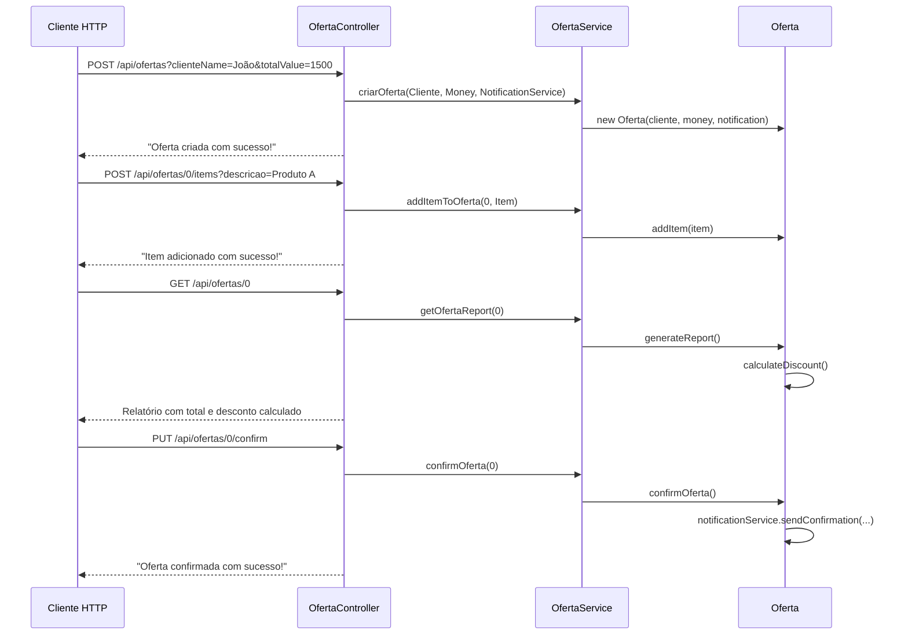

# Calisthenics — Object Calisthenics com Spring Boot

API REST que demonstra na prática os **9 princípios de Object Calisthenics** aplicados a um sistema de gerenciamento de ofertas. O foco não é o domínio em si, mas a qualidade do código: imutabilidade, encapsulamento real e entidades que têm comportamento, não apenas dados.

[](https://openjdk.org/projects/jdk/17/)
[](https://spring.io/projects/spring-boot)
[](http://localhost:8080/swagger-ui/index.html)
[](LICENSE)

---

## O que é Object Calisthenics?

São 9 regras de escrita de código que, quando seguidas, eliminam naturalmente os maus cheiros mais comuns: classes gigantes, métodos longos, primitivos espalhados e acoplamento excessivo.

| # | Regra | Onde está aplicada neste projeto |
|---|---|---|
| 1 | Um nível de indentação por método | `Oferta.calculateDiscount()`, `OfertaService.getOfertaById()` |
| 2 | Não use `else` | `Oferta.confirmOferta()` — early return implícito |
| 3 | Encapsule todos os primitivos | `Money` encapsula `double`; `Cliente` encapsula `String` nome; `Item` encapsula `String` descrição |
| 4 | Encapsule coleções | `Oferta` gerencia sua própria `List<Item>` sem expô-la |
| 5 | Um ponto por linha | Chamadas encadeadas evitadas em toda a base |
| 6 | Sem abreviações | Todos os nomes são descritivos: `totalValue`, `notificationService`, `calculateDiscount` |
| 7 | Mantenha entidades pequenas | Nenhuma classe ultrapassa 60 linhas |
| 8 | Sem classes com mais de 2 variáveis de instância | `Money(value)`, `Cliente(name)`, `Item(descricao)` — uma responsabilidade cada |
| 9 | Sem getters/setters | `Oferta` não expõe estado; age através de `addItem()`, `generateReport()`, `confirmOferta()` |

---

## Fluxo de uma Oferta



---

## Value Objects em destaque

### `Money`
Encapsula o primitivo `double`, garante imutabilidade e valida regras de negócio no próprio construtor:
```java
// Nunca: double preco = 1500.0;
// Sempre:
Money preco = new Money(1500.0); // lança exceção se negativo
Money comDesconto = preco.multiply(0.9); // retorna nova instância, não muta
```

### `Cliente` e `Item`
Encapsulam `String` e validam no construtor — nunca chegam num estado inválido ao domínio.

---

## Stack

| Tecnologia | Versão | Uso |
|---|---|---|
| Java | 17 | Linguagem principal |
| Spring Boot | 3.4.5 | Framework web |
| Spring Data JPA | — | Persistência |
| H2 Database | — | Banco em memória (zero configuração) |
| Lombok | — | Redução de boilerplate |
| Springdoc OpenAPI | 2.3.0 | Swagger UI automático |

---

## Como Executar

### Pré-requisitos
- JDK 17 ou superior
- Docker e Docker Compose (opcional, para execução via contêiner)

### Com Docker
```bash
git clone https://github.com/odavid062/Calisthenics.git
cd Calisthenics
docker compose up --build
```

### Com Maven
```bash
git clone https://github.com/odavid062/Calisthenics.git
cd Calisthenics

# Linux / macOS
./mvnw spring-boot:run

# Windows
.\mvnw.cmd spring-boot:run
```

Acesse o Swagger em: `http://localhost:8080/swagger-ui/index.html`

---

## Endpoints

| Método | Rota | Descrição |
|---|---|---|
| `POST` | `/api/ofertas` | Cria uma nova oferta |
| `POST` | `/api/ofertas/{id}/items` | Adiciona item à oferta |
| `GET` | `/api/ofertas/{id}` | Relatório com total e desconto |
| `PUT` | `/api/ofertas/{id}/confirm` | Confirma a oferta |

### Exemplos de uso

```bash
# 1. Criar oferta (valor > 1000 garante desconto de 10%)
curl -X POST "http://localhost:8080/api/ofertas?clienteName=João&totalValue=1500"

# 2. Adicionar itens (mais de 5 itens garante +5% de desconto)
curl -X POST "http://localhost:8080/api/ofertas/0/items?descricao=Produto A"
curl -X POST "http://localhost:8080/api/ofertas/0/items?descricao=Produto B"

# 3. Consultar relatório (mostra total + desconto calculado)
curl http://localhost:8080/api/ofertas/0

# 4. Confirmar oferta (dispara notificação)
curl -X PUT http://localhost:8080/api/ofertas/0/confirm
```

### Regra de desconto
- Valor total > R$ 1.000 → **10% de desconto**
- Valor total > R$ 1.000 **e** mais de 5 itens → **15% de desconto**

---

## Testes

Para executar os testes automatizados da aplicação:

```bash
# Linux / macOS
./mvnw test

# Windows
.\mvnw.cmd test
```

---

## Estrutura do Projeto

```
src/main/java/com/example/Calisthenics/
├── controller/
│   └── OfertaController.java     # Endpoints REST, delega tudo ao service
├── model/
│   ├── Money.java                # Value Object: encapsula double, imutável
│   ├── Cliente.java              # Value Object: encapsula String nome
│   ├── Item.java                 # Value Object: encapsula String descrição
│   └── Oferta.java               # Entidade rica: calcula, gera relatório, confirma
├── service/
│   ├── OfertaService.java        # Orquestra operações sobre as ofertas
│   └── NotificationService.java  # Simula envio de notificação
└── CalisthenicsApplication.java
```

---

## Autor

**David Rodrigues**
[](https://github.com/odavid062)
